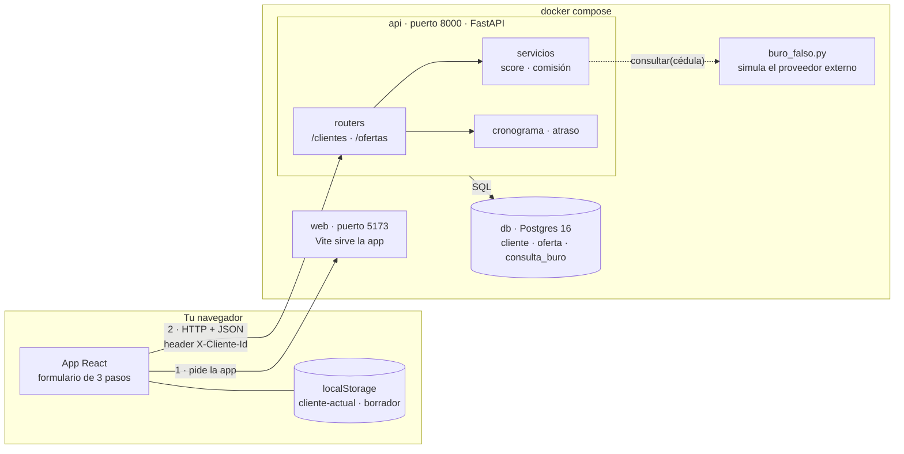

# Prueba técnica: Mini-crédito

Gracias por tomarte el tiempo. Esta es una app chica de préstamos personales, armada
a medias, parecida a los problemas que resolvemos todos los días: plata, fechas, un
proveedor externo que cobra por consulta y datos personales.

- **Tiempo:** **2 horas como máximo**. Cortá a las 2 horas aunque no hayas
  terminado y contá en `NOTAS.md` hasta dónde llegaste: preferimos pocas cosas bien
  hechas y bien explicadas.
- **Plazo:** 5 días desde que la recibís.
- **IA:** podés usar Claude, Copilot, Cursor o lo que uses normalmente. Lo que nos
  importa es tu criterio: contanos en `NOTAS.md` qué te sugirió y qué corregiste.
- **Después:** una charla de 45 minutos donde recorremos tu entrega y te pedimos un
  cambio chico en vivo. Puede estar alguien del negocio, no sólo técnicos:
  preparala para que se entienda también sin saber programar.

## Cómo entregar

1. Arriba a la derecha: **Use this template → Create a new repository**, como
   **privado** en tu cuenta. (No hagas fork: los forks de un repo público son
   públicos.)
2. Trabajá ahí, con commits chicos y mensajes claros. El historial también se lee.
3. Al terminar, invitá a **@lgallo-prestai** como colaborador y avisanos por mail.

Si no tenés cuenta de GitHub, mandanos un `.zip` del repo **con la carpeta `.git`**.

## Cómo levantarlo

Sólo necesitás **Docker** (Docker Desktop o Docker Engine con Compose v2) y `make`.

```bash
make up         # levanta Postgres, la API y la web
make test       # corre los tests de la API y de la web
make logs       # sigue los logs
make down       # apaga todo
make reset      # borra la base y arranca de cero
```

- API con documentación interactiva: http://localhost:8000/docs
- Web: http://localhost:5173

Al empezar, todos los tests pasan: los que hagan falta los escribís vos.

Si el puerto 8000 o el 5173 están ocupados, cambialos en `docker-compose.yml`. Si
algo no levanta en 10 minutos, escribinos: el problema es nuestro, no tuyo.

## Qué hay

```
api/   Python 3.12 · FastAPI · SQLAlchemy 2 · Postgres 16 · pytest
web/   React 18 · TypeScript · Vite · Vitest + Testing Library
```

Así están distribuidas las piezas cuando hacés `make up`:



- **El navegador habla directo con la API** en `localhost:8000`; el contenedor `web`
  sólo le entrega la app.
- **La base no está expuesta afuera de Docker:** sólo la ve la API. Los tests usan
  otra base, `mini_credito_test`, en el mismo Postgres.
- **El buró es un módulo dentro de la API** para que la prueba no dependa de
  internet. En la vida real sería un proveedor externo al que se llama por HTTP:
  pensalo así.

- **Login simulado:** el front manda el id del cliente en el header `X-Cliente-Id`.
  Tratalo como si viniera de un token ya validado. Hay tres clientes de prueba: Ana
  (score 820), Bruno (310) y Carla (640).
- **Buró de crédito:** `api/app/buro_falso.py` simula un proveedor externo. **No lo
  modifiques.** Cada consulta tarda y nos cuesta plata; `consultas_cobradas` es lo
  que nos facturaría.
- **Cronograma:** `api/app/cronograma.py` ya está hecho. No hace falta tocarlo.

## Reglas del negocio

- Un cliente puede pedir un préstamo si su score es **500 o más**.
- Plazos de 3, 6 o 12 meses, cada uno con su **monto máximo** y su **TEA**
  (`api/app/config.py`).
- **Comisión administrativa:** 2 % del monto, redondeada al centavo.
- **Una consulta al buró sirve 30 días** para el mismo cliente.
- Operamos en Uruguay: **las fechas de vencimiento son en hora de Montevideo.**

## Cómo encararlo

Una guía, no una obligación. Es como trabajaríamos nosotros con 2 horas.

1. **Primero hacelo andar** (~10 min). `make up`, abrí la web, pedí un préstamo
   como Ana y como Bruno, mirá la API en `/docs` y corré `make test`. Entender
   qué hace hoy ahorra tiempo después.
2. **Leé antes de escribir.** Recorré `api/app/` y `web/src/` con el diagrama de
   arriba al lado. Es poco código: leelo entero, no sólo lo que nombran las tareas.
3. **Planificá el tiempo.** Mirá los tiempos de cada tarea y elegí el orden. Dejá
   **unos 45 minutos** para `ARQUITECTURA.md`, la sección del agente y `NOTAS.md`: si los dejás para el
   final, se comen el tiempo que no tenés.
4. **De a una tarea, con su test y su commit.** Escribí el test que muestra el
   problema, arreglalo y commiteá. Un historial con un commit por tarea se lee
   mucho mejor que uno solo al final.
5. **En cada cambio, preguntate qué puede salir mal**: qué pasa si llega dos
   veces, si algo externo falla o tarda, y qué datos personales toca. Si lo ves y
   no te da el tiempo de resolverlo, anotalo en `NOTAS.md`: también suma.
6. **Usá la IA, pero leé lo que te da.** Si no podés explicar una línea, no la
   entregues. Anotá qué le corregiste.
7. **A las 2 horas, cortá.** Preferimos 4 tareas bien hechas y bien explicadas
   antes que 6 a medias.
8. **Prepará la charla.** Vas a recorrer tu entrega con nosotros, explicar por qué
   decidiste lo que decidiste y hacer un cambio chico en vivo sobre tu propio
   código. Lo más importante de la prueba es que puedas defender lo que hiciste.
9. **Pensá cada decisión también como negocio.** Para cada decisión importante,
   tené clara una respuesta corta a «¿y esto qué le cambia a la empresa?»: cuánto
   cuesta (por ejemplo, consultas al buró que se pagan), qué riesgo evita (plata,
   datos personales, regulación), qué ve el cliente (un error, una demora, un
   aviso) y cuánto frena o acelera al equipo. Explicalo sin jerga: si quien te
   escucha no es técnico, igual tiene que entender por qué tu decisión conviene.

## Tareas

Los tiempos son orientativos. Elegí el orden; si no llegás a todo, contanos en
`NOTAS.md` qué dejaste afuera y por qué.

1. **Crear una oferta bien** (~25 min). `POST /ofertas` hoy no valida el monto
   máximo del plazo, y si el cliente hace doble clic en «Confirmar» se crean dos
   ofertas. Arreglalo para que **no pueda haber dos ofertas pendientes del mismo
   cliente**, aunque lleguen dos requests al mismo tiempo. Del lado de la web, que
   tampoco se pueda mandar dos veces.
2. **No pagar dos veces al buró** (~15 min). Cada llamada a elegibilidad o a crear
   una oferta consulta al buró de nuevo. Usá la consulta guardada si tiene menos de
   30 días.
3. **El borrador de la solicitud** (~15 min). El formulario de la web guarda un
   borrador para retomarlo. Hoy, si Ana deja un borrador a medias, sale y entra
   Bruno en la misma computadora, Bruno ve el monto, el teléfono y la dirección de
   Ana. Arreglalo, y que el borrador se borre cuando la solicitud se envía. Con
   tests.
4. **Revisión de código** (~10 min). En el código que ya existe hay **al menos un
   bug** que no está en esta lista. Encontralo y arreglalo (o, si no te da el
   tiempo, explicalo en `NOTAS.md`).
5. **Arquitectura** (~25 min, sin código). En `ARQUITECTURA.md`, en la raíz:
   - **Cómo funciona hoy.** Partiendo del diagrama de piezas de arriba, un
     diagrama de qué pasa desde que el cliente aprieta «Confirmar» hasta que tiene
     su oferta, **con tus cambios ya hechos**. Recomendamos
     [Mermaid](https://mermaid.js.org), que GitHub muestra directo en el Markdown.
   - **Cómo la harías crecer.** Imaginá que en un año hay una app móvil además de
     la web, un segundo buró, avisos por SMS y email cuando se aprueba una oferta,
     y 4 desarrolladores trabajando a la vez. ¿La partirías en microservicios?
     Si sí: qué servicios, de qué datos es dueño cada uno, cómo se comunican
     (llamada directa o eventos) y cómo seguís garantizando que no haya dos ofertas
     pendientes ni dos pagos al buró. Qué pasa si uno se cae.
   - **Qué no partirías y por qué.** «Todavía no lo partiría» también es una
     respuesta válida si la justificás.
   - **Qué impacto tiene en el negocio.** Para tu propuesta: qué cuesta (de
     infraestructura y de trabajo del equipo), qué riesgo baja o sube, qué nota el
     cliente cuando algo falla, y qué conviene hacer primero si no se puede todo.

   No miramos que conozcas tal herramienta: miramos que las decisiones tengan un
   motivo y que veas lo que cuesta cada una. En la charla lo recorremos juntos.
6. **Cómo trabajás con tu agente** (~10 min). Queremos ver cómo trabajás con un
   agente de código (Claude Code, Cursor, Codex o el que uses):
   - **Commiteá la configuración que usaste en este repo**: el archivo de
     instrucciones del proyecto (`CLAUDE.md`, `AGENTS.md` o el que use tu
     herramienta) y, si armaste alguna, una skill o comando propio. **Sin claves ni
     tokens.**
   - En `NOTAS.md`, una sección **«Agente»**, corta:
     - qué le dejaste en la memoria del proyecto y por qué, y qué dejaste afuera;
     - qué MCP (o integraciones) conectarías para trabajar en este proyecto todos
       los días, para qué, y cuál no conectarías;
     - cómo cuidaste el contexto y los tokens: qué le diste a leer, cuándo
       arrancaste de cero, qué delegaste;
     - cómo organizarías un día de trabajo con el agente en un proyecto así.

   Si no usás agentes, contanos igual cómo organizarías el trabajo con uno.
7. **`NOTAS.md`** (~10 min). En la raíz, corto:
   - qué hiciste y qué dejaste afuera, y por qué;
   - las decisiones que tomaste, qué alternativas descartaste y qué impacto tiene
     cada una en el negocio (costo, riesgo, experiencia del cliente);
   - cómo usaste la IA, si la usaste, y qué le corregiste.

## Qué miramos

- Que funcione y tenga tests que prueben lo que importa.
- Cómo manejás plata y concurrencia.
- Datos personales: qué guardás y qué logueás.
- Que entiendas cómo funciona el sistema y puedas proponer cómo hacerlo crecer.
- Cómo trabajás con agentes de código: qué les das, qué les pedís y cómo
  revisás lo que hacen.
- Que conectes tus decisiones técnicas con el negocio y las puedas explicar a
  alguien que no es técnico.
- Código claro, que se entienda sin vos al lado.

No miramos: diseño visual, cantidad de líneas ni que uses tal o cual librería.

¡Suerte! Cualquier duda, escribinos.
